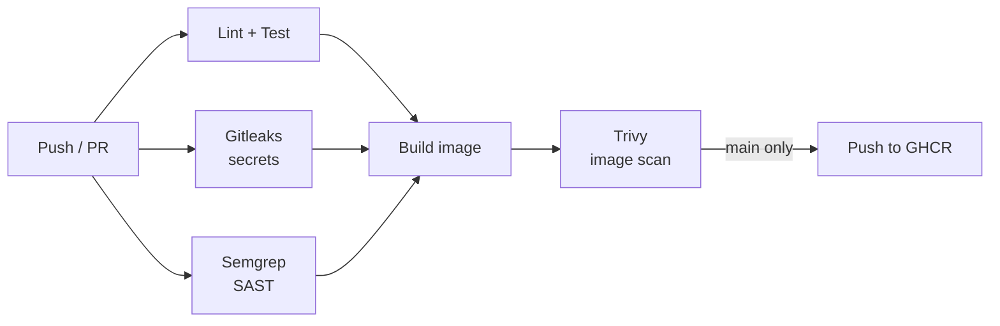
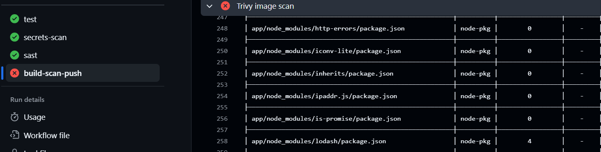
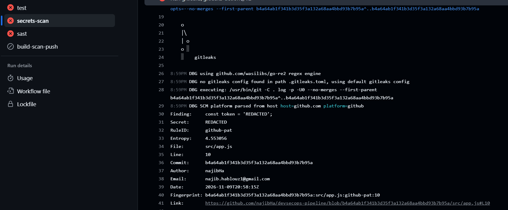
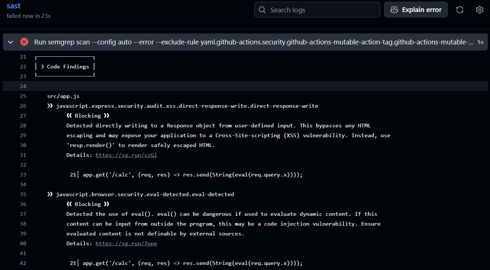
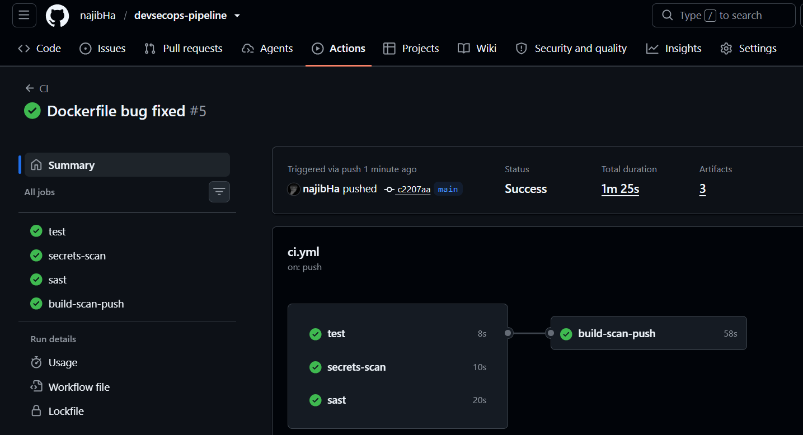

# devsecops-pipeline

A CI/CD pipeline that shifts security left: every push and pull request is scanned for leaked secrets, insecure code, and vulnerable dependencies and images before an image is published.

## Pipeline

| Check | Tool | Catches | Blocks on |
|---|---|---|---|
| Secrets | Gitleaks | Keys and tokens in code or history | Any finding |
| SAST | Semgrep | Insecure code patterns (e.g. `eval`) | Any finding |
| Image / deps | Trivy | Known CVEs in packages and base image | CRITICAL / HIGH with a fix |
| Updates | Dependabot | Outdated npm, Docker, Actions versions | Opens PRs |

## Proof it works

I broke the pipeline on purpose, once per scanner.

| Trivy: vulnerable lodash | Gitleaks: fake token |
|---|---|
|  |  |

| Semgrep: `eval` on user input | Full green run |
|---|---|
|  |  |

## Design decisions

- **Scan before publish:** the image is built locally, scanned, and only pushed if clean, so a vulnerable image never reaches the registry.
- **Gate with `needs`:** the build job waits for tests, secret scan and SAST.
- **Full history for Gitleaks:** `fetch-depth: 0` scans old commits, not just the latest one.
- **`ignore-unfixed`:** Trivy only fails on vulnerabilities that have a patch available, so the build isn't blocked by issues nobody can fix yet.
- **Least privilege:** read-only token by default, `packages: write` only on the job that pushes.
- **Dependabot on three ecosystems:** npm, Docker base image and Actions are all kept current.

## Learning value

- What "shift left" means in practice: findings appear on the PR, not in production.
- Deleting a leaked secret doesn't remove it from Git history, so the secret must be rotated.
- Scanner severity and `ignore-unfixed` trade-offs: strict blocking vs. alert fatigue.
- Dev dependencies are excluded from the image, so they don't show up in the image scan.

## Limitations

- Scanners find known patterns only, not every vulnerability.
- Semgrep `--config auto` uses community rules and is not tuned to this app.

## Next steps

- Upload results to the GitHub Security tab (SARIF).
- Sign images with Cosign.
- Scan Terraform and Kubernetes manifests (Checkov, tfsec).
